<div align="center">




</div>



<div align="center">

</div>


## ⟩ `whoami`

```ts
const kawe: Engineer = {
  role:       ["Software Engineer", "Solutions Architect", "Offensive Security (in training)"],
  location:   "Mogi das Cruzes, SP — Brazil",
  focus:      ["Offensive Security", "Cloud & IoT Hardening", "Distributed Systems"],
  building:   ["Eryno (CEO)", "Artec Solar (CIO)", "GA230 (Analyst)"],
  team:       "Purple — I build the systems I learn to attack.",
  philosophy: "Right-sized solutions over premium defaults.",
};
```

I work at the intersection of **technical implementation** and **business strategy**: systems robust enough to scale and pragmatic enough to ship. That means distributed architectures on Raspberry Pi fleets, cloud-native infrastructure, and ERP platforms with AI built in.

Now I'm turning the builder's view into an attacker's view. I've shipped auth flows, RBAC, MQTT brokers and edge devices on a real factory floor, so I know where they crack. I study pentest and red-team tradecraft so that everything I build ships **hardened by design**.

## ⟩ `ls ~/arsenal`

<table>
<tr>
<td width="50%" valign="top">

**⚔️ Offense & recon**


</td>
<td width="50%" valign="top">

**🛡️ Build & defend**


</td>
</tr>
</table>

## ⟩ `tail -f /var/log/ops.log`

```diff
+ [learning]   web & API pentesting — OWASP Top 10, auth bypass, IDOR, SSRF
+ [learning]   Linux & Active Directory privilege escalation
+ [lab]        IoT / MQTT attack surface on my own Raspberry Pi fleet
+ [building]   multi-tenant ERP with RBAC, branch isolation and audit trails
+ [hardening]  GCP IAM — least-privilege service accounts, secret management
! [next]       certification path: eJPT → OSCP
```

## ⟩ `cat /proc/stats`

<div align="center">


<picture>
  <source media="(prefers-color-scheme: dark)" srcset="https://raw.githubusercontent.com/KaweMaximo/KaweMaximo/output/snake-dark.svg" />
  
</picture>

</div>


> [!IMPORTANT]
> **Rules of engagement.** Everything I test is my own, a lab, a CTF, or in scope with written authorization. White hat, always.

<div align="center">
<sub><code>root@kawe:~# echo "every system is secure until someone gets curious."</code></sub>
</div>
